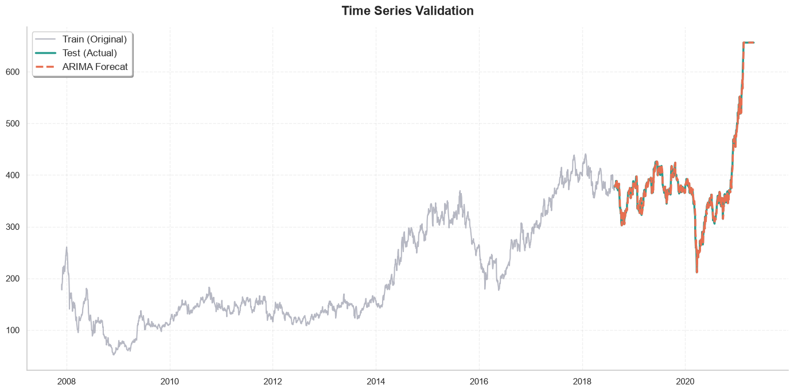

[](https://www.python.org/)
[](https://en.wikipedia.org/wiki/Cross-industry_standard_process_for_data_mining)
[](https://keras.io/api/layers/recurrent_layers/simple_rnn/)
[-green.svg)](https://alkaline-ml.com/pmdarima/)
[](https://opensource.org/licenses/MIT)

# ADANIPORTS Time Series Forecasting

An end-to-end quantitative financial time series forecasting system applied to **Adani Ports and Special Economic Zone Ltd (`ADANIPORTS`)** equity data from the National Stock Exchange of India (NSE).

The primary objective is forecasting the daily **Volume Weighted Average Price (VWAP)** using both classical statistical econometrics and deep sequence learning models. The system is engineered using **Object-Oriented Programming (OOP)** and clean architectural patterns, allowing the entire workflow to run as a reproducible, automated pipeline.

---

## Project Overview
> **Author:** Seyed Reza Zibjou  
> **Asset:** Adani Ports and SEZ Ltd (`ADANIPORTS.csv`)  
> **Time Horizon:** November 27, 2007 – April 30, 2021 (3,322 trading days)  
> **Target Feature:** Volume Weighted Average Price (`VWAP`)  

---

## System Architecture & Pipeline Workflow

The repository is organized around a strictly decoupled pipeline where each stage transforms and delivers clean statistical artifacts to the next phase:
```text
[Raw Dataset] ──► [DataExplorer] ──► [DataPreparation] ──► [Modeling] ──► [ModelEvaluation] ──► [Forecast (INR)]
```

The complete pipeline can be summarized as:

```text
                    Raw Dataset
                         │
                         ▼
                Data Understanding
                         │
                         ▼
                       EDA
                         │
          ┌──────────────┴──────────────┐
          │                             │
          ▼                             ▼
    Distribution                  Time Series
      Analysis                     Analysis
          │                             │
          └──────────────┬──────────────┘
                         ▼
                 Stock Split Adjustment
                         │
                         ▼
                  Outlier Treatment
                         │
                         ▼
                 Box-Cox Transformation
                         │
                         ▼
                  Differencing / ADF
                         │
                         ▼
                  ACF / PACF Analysis
                         │
                         ▼
                  Train / Test Split
                         │
             ┌───────────┴───────────┐
             │                       │
             ▼                       ▼
          ARIMA                    Simple RNN
             │                       │
             ▼                       ▼
          Forecast                 Forecast
             │                       │
             └───────────┬───────────┘
                         ▼
                 Inverse Transform
                         │
                         ▼
                     Evaluation
                         │
                         ▼
                    MAE / RMSE
                         │
                         ▼
                  Model Comparison
```

---

## Repository Structure

```text
TIME-SERIES_ADANI_PORTS/
│
├── assets/
│   ├── output.png                       # Pipeline and architectural schema diagram
│   └── validation_results.png           # Actual vs Predicted time-series validation plot
│
├── data/
│   └── ADANIPORTS.csv                   # Historical daily stock data (NSE India, 2007–2021)
│
├── notebooks/
│   ├── adaniports_full_code_oop.ipynb   # Monolithic reference notebook containing full OOP classes
│   └── adaniports_based_on_modules.ipynb# Clean, production-style notebook importing from src modules
│
├── src/
│   ├── __init__.py                      # Package initialization
│   ├── data_explore.py                  # DataExplorer: EDA, decomposition, autocorrelation audits
│   ├── data_preparation.py              # DataPreparation: split adjustment, clipping, Box-Cox, diff
│   ├── modeling.py                      # Modeling: ARIMA, AutoARIMA, 3D RNN sequence generators
│   └── evaluate.py                      # ModelEvaluation: metrics computation, inverse scales, plots
│
├── .gitignore                           # Git exclusion rules
├── main.py                              # End-to-end automated command-line execution script
├── README-fa.md                         # Persian documentation (مستندات فارسی پروژه)
├── README.md                            # Comprehensive English documentation
└── requirements.txt                     # Pinned project dependencies
```
---

## Core Modular Architecture (`src/`)

The core business logic is encapsulated in four modular packages within `src/`:

### 1. `data_explore.py` (`DataExplorer`)
Implements comprehensive exploratory time-series analysis through fluent method chaining:
* **Visual Diagnostics:** Time-series evolution, rolling mean, rolling standard deviation, distributions (Hist/Box).
* **Statistical Decomposition:** Additive & multiplicative trend, seasonality, and residual isolation.
* **Correlation Profiling:** Autocorrelation Function (ACF) and Partial Autocorrelation Function (PACF) plots.
* **Anomaly Auditing:** Identifies extreme market events, including the unadjusted **80.01% price plunge** on **September 23, 2010**.

### 2. `data_preparation.py` (`DataPreparation`)
Inherits from `DataExplorer` to execute statistical transformations while maintaining state:
* **Corporate Action Adjustment:** Corrects for the **5:1 Stock Split** on `2010-09-23` by scaling pre-split VWAP.
* **Tail-Risk Handling:** Caps severe volatility spikes using IQR boundary clipping ($1.5 \times \text{IQR}$).
* **Variance Stabilization:** Applies Box-Cox power transformation with automatic parameter estimation ($\lambda \approx 0.1430$).
* **Stationarity Induction:** Seasonal first-order differencing ($d=1$).
  * *Raw Series ADF:* $p = 0.9843$ (Non-stationary)
  * *Transformed ADF:* Statistic $= -50.0329$, $p = 0.0000$ (Stationary)

### 3. `modeling.py` (`Modeling`)
Orchestrates statistical training and deep recurrent sequence generation:
* **Sequence Framing:** Generates 3D sliding window tensors for sequence models (`step = 10` trading days).
* **Classical Econometrics:** AutoARIMA hyperparameter tuning & manual Grid Search over $(p, d, q)$ space.
* **Deep Neural Network:** SimpleRNN architecture (`Input(10, 1)` $\rightarrow$ `SimpleRNN(64)` $\rightarrow$ `Dense(1)`) trained with `EarlyStopping` and `ReduceLROnPlateau`.
* **Inversion Engine:** Reverses differencing and Box-Cox power transform to map predictions back to Indian Rupees (INR).

### 4. `evaluate.py` (`ModelEvaluation`)
Handles model assessment against test datasets:
* **Error Metrics:** Calculates Mean Absolute Error (**MAE**) and Root Mean Squared Error (**RMSE**) on original price scale.
* **Validation Visualizations:** Plots historical training data, actual test observations, and multi-model forecast curves side-by-side.

---

## Notebook Environments

The project provides two distinct notebook workflows to suit different development needs:

1. **`adaniports_based_on_modules.ipynb` (Recommended):**
   * Acts as a high-level orchestration interface.
   * Directly imports classes from `src.data_explore`, `src.data_preparation`, `src.modeling`, and `src.evaluate`.
   * Free of redundant boilerplate; focuses on analytical insights and visualization.

2. **`adaniports_full_code_oop.ipynb`:**
   * A standalone, monolithic reference notebook.
   * Embeds all class definitions (`DataExplorer`, `DataPreparation`, `Modeling`) directly within notebook cells for self-contained execution without directory dependencies.

---

## The Pipeline Concept

Rather than treating data cleaning, modeling, and evaluation as isolated manual steps, the system treats them as an interconnected pipeline.

### Interactive Pipeline (Method Chaining)
```python
from src.data_preparation import DataPreparation
from src.modeling import Modeling
```
# Data preparation pipeline
```python
prepared = (
DataPreparation(df, target="VWAP")
.adjust_stock_split(split_date="2010-09-23", ratio=5)
.clipping()
.apply_boxcox()
.apply_seasonal_diff(period=1)
)
```
# Modeling
```python
arima_instance = Modeling(prepared_data)
train_data, test_data = arima_instance.train_test_split(
model_type="ARIMA", train_size=0.8
)
arima_instance.fit_arima(order=(0, 0, 1))
```

### Automated Batch Pipeline (`main.py`)
For headless production environments, `main.py` executes the entire pipeline sequentially from raw CSV extraction to final model evaluation in a single command.

---

## Benchmark & Validation Results

Evaluated on the out-of-sample holdout set (**80% Train / 20% Test** split):

| Model Architecture | Hyperparameters / Specs | MAE (INR) | RMSE (INR) | Status |
| :--- | :---: | :---: | :---: | :---: |
| **ARIMA** | $(0, 0, 1)$ — MA(1) | **4.9400** | **7.2838** | 🏆 **Best Model** |
| **SimpleRNN** | Lookback = 10, Units = 64 | 4.9976 | 7.3602 | Competitive |

### Time Series Validation Plot
Below is the visual tracking of the actual test prices against the ARIMA forecast in Indian Rupees (INR):



> **Key Takeaway:** While SimpleRNN successfully learned temporal dynamics and local autocorrelation, classical ARIMA(0,0,1) achieved slightly superior accuracy with significantly lower computational complexity. The chart confirms close tracking of out-of-sample market dynamics even during rapid post-2020 price appreciation.

---

## Getting Started

### 1. Installation

# Clone repository
```text
git clone https://github.com/SeyedRezaZibjou/Time-Series_Adaniports.git
cd TIME-SERIES_ADANI_PORTS
```
# Create virtual environment
```text
python -m venv .venv
```

# Activate environment
# On Windows:
```text
.venv\Scripts\activate
```
# On Linux/macOS:
```text
source .venv/bin/activate
```
# Install dependencies
```text
pip install -r requirements.txt
```

### 2. Execution Options

* **Run the automated batch pipeline:**
  ```text
  python main.py
  ```
